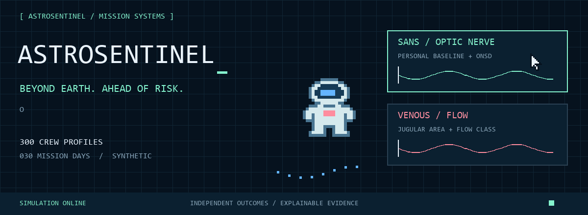
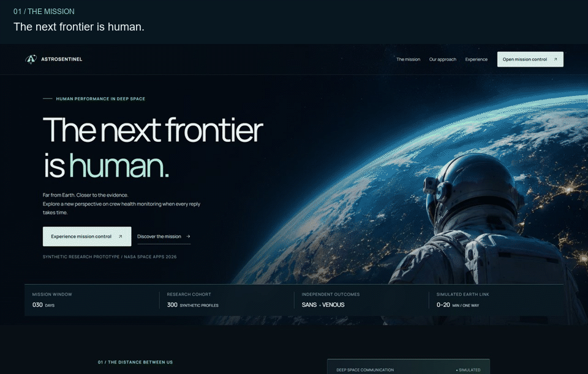
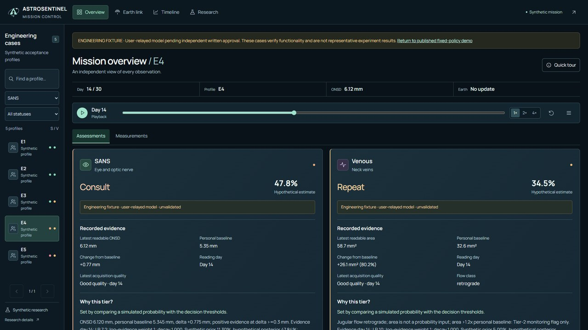
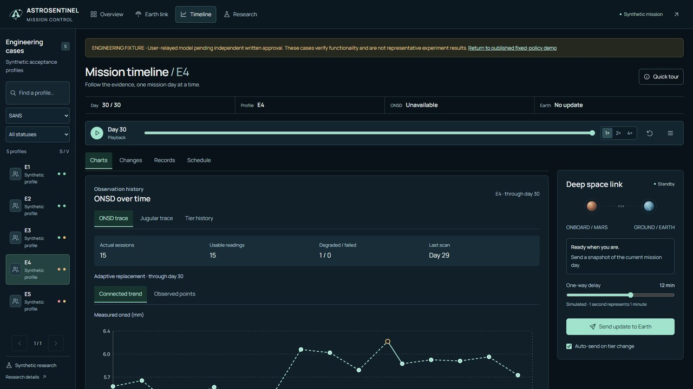
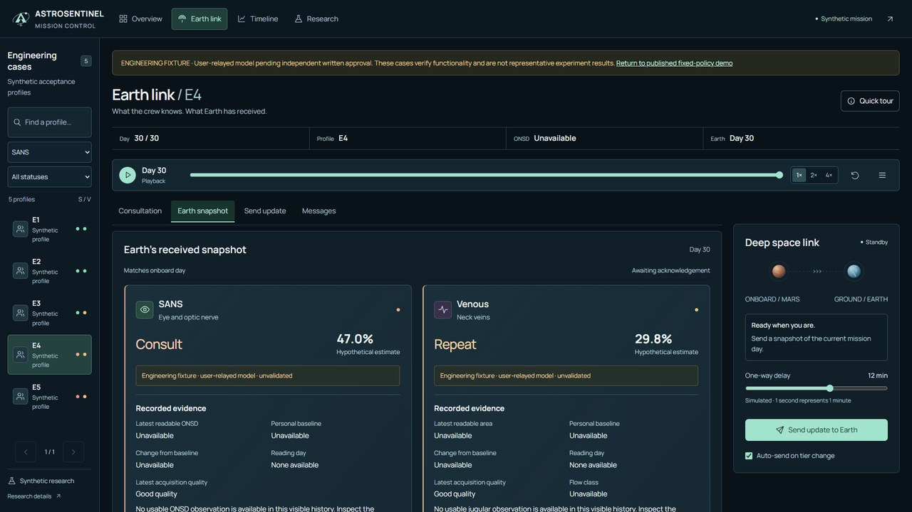
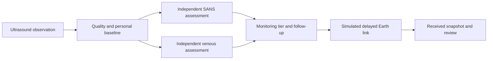

<div align="center">
  <h1>AstroSentinel</h1>
  
  <p><strong>The next frontier is human.</strong></p>
  <p>Crew-health evidence, ultrasound monitoring, and a delayed view from Earth.</p>
  <p><a href="https://astrosentinel-deep-space-health.vercel.app"><strong>Launch mission control ↗</strong></a> · <a href="#explore-the-platform">Explore the platform</a> · <a href="#research-results">Research results</a> · <a href="#quick-start">Run locally</a></p>
  <p><code>REACT</code> &nbsp; <code>PYTHON</code> &nbsp; <code>SYNTHETIC RESEARCH</code> &nbsp; <code>NASA SPACE APPS 2026</code></p>
</div>

> **Research prototype · Synthetic data · Not clinically validated.** No real medical diagnosis or flight-readiness claim. Earth communications and medical consultations are simulated.

---

## The mission

Far from Earth, the body changes while the ground team waits for a signal. AstroSentinel explores how astronauts could follow ultrasound evidence, understand independent monitoring outcomes, and share a clear snapshot across a simulated communication delay.

The platform brings together **SANS** (Spaceflight-Associated Neuro-ocular Syndrome) and **venous-stasis monitoring**, personal baselines, measurement quality, scan scheduling, and reproducible research.

| 300 | 30 | 9,000 | 2 |
| :---: | :---: | :---: | :---: |
| Synthetic astronauts | Mission days | Astronaut-day records | Independent outcomes |

## Explore the platform

<a href="https://astrosentinel-deep-space-health.vercel.app">
  
</a>

*Actual application captures, connected with fade transitions. The 300-profile research cohort, E1–E5 engineering acceptance cases, and aggregate engineering comparison are separate datasets; their labels remain visible.*

| Onboard evidence | Across the mission | Back on Earth |
| :--- | :--- | :--- |
| **Independent assessments** — separate SANS and venous outcomes, with reasons and follow-up actions. | **Observation history** — ONSD and jugular traces, tier history, recorded changes, and scan records. | **Delayed snapshots** — see what the crew knows and what Earth has actually received. |
| **Personal baselines** — inspect changes in ONSD, jugular area, and flow alongside acquisition quality. | **Playback and scheduling** — move through 30 mission days and inspect fixed, adaptive, and retry decisions where available. | **Simulated consultations** — follow a request, evidence packet, ground review, response, and audit trail. |
| **Cohort browser** — search profiles and filter independent outcome statuses. | **Explainable tiers** — Monitor, Repeat, Consult, and Urgent, with unavailable estimates shown explicitly. | **Research workspace** — inspect results, engineering comparisons, model capabilities, blockers, and run provenance. |

**Start a guided exploration:** [Landing](https://astrosentinel-deep-space-health.vercel.app) → [Mission deck](https://astrosentinel-deep-space-health.vercel.app/#mission) → [Overview](https://astrosentinel-deep-space-health.vercel.app/#dashboard) → [Timeline](https://astrosentinel-deep-space-health.vercel.app/#timeline) → [Earth link](https://astrosentinel-deep-space-health.vercel.app/#ground) → [Research](https://astrosentinel-deep-space-health.vercel.app/#research).

<details>
<summary><strong>Open the still-image gallery</strong></summary>

| Mission overview · engineering example | Timeline · engineering example |
| :---: | :---: |
|  |  |

| Earth snapshot · engineering example | Research results · Mars30 |
| :---: | :---: |
|  |  |

</details>

## From observation to Earth



The monitoring views use published observations and assessments. Scan decisions and comparisons are computed offline; browser playback reveals the published mission history. Earth Link and consultation timing run locally in the browser.

## Research results

The **Mars30 synthetic study** compares fixed SANS scan intervals against adaptive scanning with a fixed backstop and triggered extra scans. These are computed simulation results, not clinical performance measurements.

| Scan interval | Fixed detected / 124 events | Adaptive detected / 124 events | Days saved per extra scan | False-escalation rate: fixed → adaptive |
| :--- | :---: | :---: | :---: | :---: |
| 3 days | 93 | 98 | 0.97 | 18.2% → 18.8% |
| 7 days | 91 | 101 | 0.88 | 8.5% → 10.2% |
| 14 days | 60 | 84 | 0.94 | 1.1% → 6.8% |

**The trade-off:** adaptive scanning detects more synthetic events and reduces delay while using more scans and producing more false escalations. Evaluate all four together.

[Read the methodology and complete results →](docs/research/results/RESULTS_FOR_SLIDES.md) · [Inspect the computed comparison](docs/research/results/mars30_schedule_comparison.json) · [Open the published results data](frontend/public/data/research/results.json)

<details>
<summary><strong>Scientific assumptions, dataset boundaries, and limitations</strong></summary>

- Every astronaut, observation, and event is synthetic. No clinical validation or real medical diagnosis is claimed.
- The Mars30 dataset contains 300 astronauts across 30 days, with seed 2026. Train / validation / test splits contain 210 / 45 / 45 astronauts, with no astronaut shared between splits.
- The corrected Mars30 SANS rule uses the latest quality-OK ONSD reading relative to the median of the first three quality-OK readings available in the astronaut’s visible history. A delta of at least 0.4 mm is positive.
- The LR+ / LR− values (6.93 / 0.04) come from an absolute-cutoff ICU/ICP test. Reusing them for a baseline-relative SANS test is an explicit modeling assumption. The 5% starting prior is an unsourced simulation placeholder.
- Under that single-reading SANS model, the posterior cannot reach the 40% Consult threshold. Engineering acceptance cases demonstrate additional states under a separate, explicitly labeled model.
- SANS progression, onset timing, jugular-flow simplifications, and HRV-proxy trigger accuracy are simulation assumptions. The scheduling study uses an assumed trigger accuracy of 0.7; the documented sweep spans 0.5–0.9.
- The Mars30 results, E1–E5 engineering cases, and aggregate engineering comparison have different purposes and must not be treated as interchangeable evidence.
- Registry approvals record user-relayed authorization for the synthetic submission experiment, not independent written research-lead sign-off, peer review, or clinical approval.
- An earlier absolute-cutoff study produced unusable false-escalation rates. Its superseded outputs remain in the [audit archive](docs/research/results/AUDIT_superseded_absolute_cutoff_run/).

See the [assumption registry](backend/registry/data/assumptions.json) and [full study notes](docs/research/results/RESULTS_FOR_SLIDES.md) for provenance.

</details>

## Quick start

### Launch the frontend

```bash
git clone https://github.com/Hasee10/astrosentinel-deep-space-health.git
cd astrosentinel-deep-space-health/frontend
npm ci
npm run dev
```

Open the local URL printed by Vite, usually **http://localhost:5173**. The frontend reads published static data; no Python server is required.

```bash
npm run build       # Production files in frontend/dist
npm run check:data  # Check the public-data boundary before deployment
```

<details>
<summary><strong>Reproduce the Python research pipeline</strong></summary>

From the repository root:

```bash
cd backend
python -m venv .venv
```

Activate the environment with `source .venv/bin/activate` on macOS / Linux or `.venv\Scripts\Activate.ps1` in PowerShell. Then, from `backend/`:

```bash
pip install -r requirements.txt
python -I -m pytest tests/ -q
python -I datasets/mars30/validate_dataset.py datasets/mars30
python -m evaluation.mars30_schedule_comparison
python mars30_to_pipeline.py --output-dir outputs/mars30_pipeline
```

To reproduce the ML baseline, run from `backend/datasets/mars30/`:

```bash
python baseline_example.py
```

After the baseline, comparison, and scoring outputs exist, run from `backend/`:

```bash
python publish_research_results.py
```

The source-document hash checks **skip** when the privately retained primary documents are absent. To run those checks, provide the original `Mission_NASA_updated.docx`, `Mission_NASA(1).docx`, and `vn.txt` files at the repository root. These documents are intentionally excluded from the public repository.

</details>

<details>
<summary><strong>Architecture and technology</strong></summary>

| Layer | Responsibility | Technology |
| :--- | :--- | :--- |
| Research data | Synthetic cohort, observation generation, astronaut-level splits | Python, pandas, NumPy |
| Monitoring | Independent assessments, quality handling, personal baselines | Python, Pydantic |
| Evaluation | Scheduling comparisons and ML reference baselines | scikit-learn, pytest, Matplotlib |
| Publication | Sanitized JSON / JSONL and reproducible aggregate reports | Offline Python scripts |
| Mission workspace | Profiles, charts, playback, simulated Earth Link | React, Vite, Recharts |
| Verification | Browser flows, presentation logic, public-data checks | Playwright, Node.js, ESLint |

```text
backend/datasets/mars30/     Synthetic source dataset
backend/registry/           Assumptions and parameter provenance
backend/monitoring/         Monitoring assessment engine
backend/evaluation/         Scheduling and comparison code
         │
         ▼  offline publication
frontend/public/data/       Sanitized observations and computed results
         │
         ▼  static fetch
frontend/src/               Interactive mission workspace
```

Dependency versions are recorded in [frontend/package.json](frontend/package.json) and [backend/requirements.txt](backend/requirements.txt). The frontend does not call a live Python inference API. Its Earth Link is a client-side simulation.

</details>

<details>
<summary><strong>Submission snapshot and visual assets</strong></summary>

The tag [`v1.0.0-final-submission`](https://github.com/Hasee10/astrosentinel-deep-space-health/tree/v1.0.0-final-submission) preserves the submission snapshot. Later README and repository-maintenance commits may appear after that tag; individual files retain their own development history.

README animations are self-contained GIFs with no external animation service. Their source captures are included in `docs/readme/screens/`. To rebuild them, install Pillow and run `python docs/readme/generate_assets.py` from the repository root.

</details>

---

<div align="center">
  <p><strong>Keep the human in the mission.</strong></p>
  <p>Built by <strong>SHIFU HAWKS</strong> · Maintained by <a href="https://github.com/Hasee10">Hasee10</a></p>
  <p><a href="https://astrosentinel-deep-space-health.vercel.app"><strong>Experience AstroSentinel ↗</strong></a> · <a href="docs/research/results/RESULTS_FOR_SLIDES.md">Explore the research</a> · <a href="https://github.com/Hasee10/astrosentinel-deep-space-health">Browse the code</a></p>
  <sub>Synthetic research demonstration. Monitoring only. Not clinically or flight validated.</sub>
</div>
