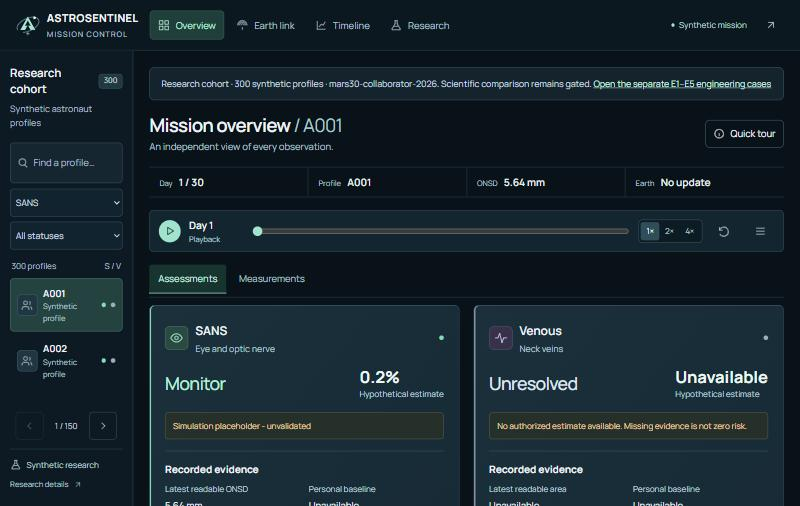
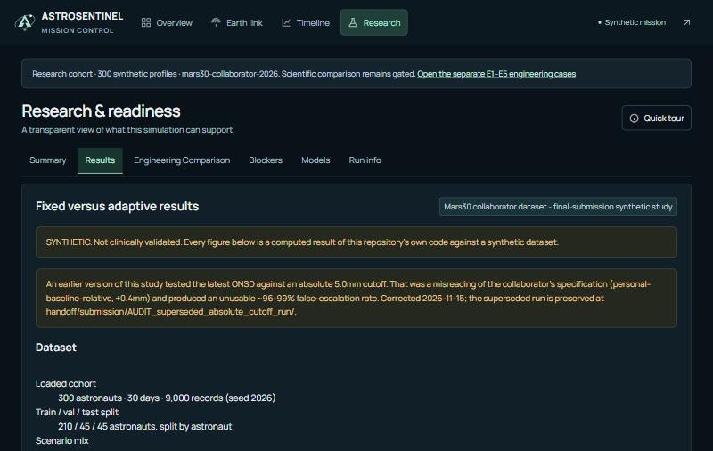
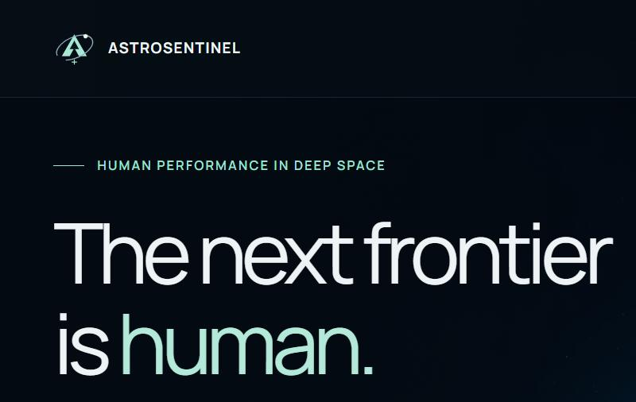
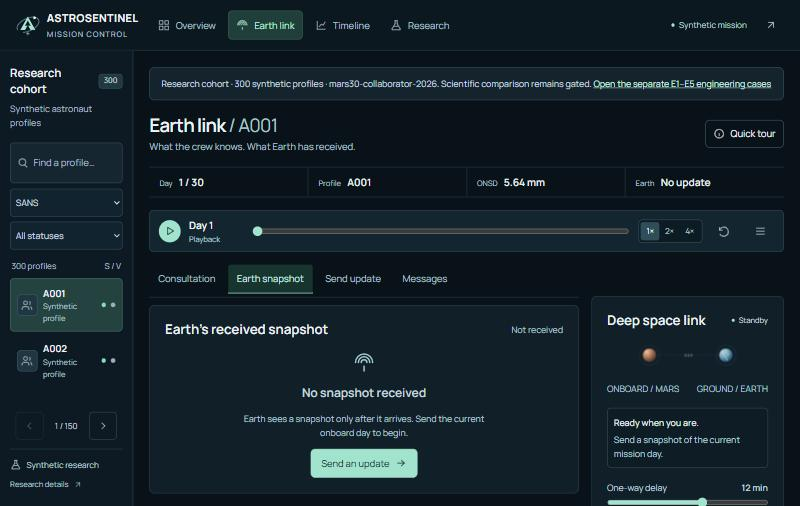

<div align="center">

# ASTROSENTINEL

**Beyond Earth. Ahead of risk.**

Synthetic deep-space astronaut health monitoring research platform — SANS and venous-stasis surveillance, fixed-vs-adaptive ultrasound scheduling, and delayed Earth communication, built around a 300-astronaut / 30-day synthetic cohort.

**Research prototype. Not clinically validated. No real medical diagnosis.**

[Live demo](https://astrosentinel-deep-space-health.vercel.app) · [Research results](docs/research/results/RESULTS_FOR_SLIDES.md) · [Reproduce the study](#quick-start) · [Final submission](#final-submission)

</div>

---

## Screenshots

| Mission overview | Research results |
|---|---|
|  |  |

| Landing | Earth Link |
|---|---|
|  |  |

All four are real captures of the running application against the actual Mars30 dataset, not mockups.

## Project identity

AstroSentinel is a synthetic research platform exploring two deep-space crew-health questions: can optic-nerve-sheath-diameter (ONSD) ultrasound detect SANS (Spaceflight-Associated Neuro-ocular Syndrome) progression, and does scheduling extra scans adaptively (in response to a weak physiological trigger) outperform a fixed scanning interval, given that any finding has to travel back to Earth over a communication delay of 0–20 minutes one-way.

Every number this project produces is computed from a synthetic dataset (either its own generator or the collaborator-provided **Mars30** dataset: 300 astronauts × 30 days, seed 2026) and is explicitly labeled **"Simulation placeholder - unvalidated"** wherever it reaches the UI. Nothing here is a medical device, a diagnostic tool, or a clinically validated model.

## Mission at a glance

- **300** synthetic astronauts
- **30** mission days each
- **9,000** astronaut-day records
- **2** independently-assessed outcomes: SANS and venous stasis (never a combined score)
- **3** scan-schedule policies compared: fixed 3-day, fixed 7-day, fixed 14-day, each against an adaptive (fixed-backstop + triggered-extra-scan) counterpart

## The problem

A Mars transit puts a 0–20 minute one-way communication delay between a crew and the flight surgeons who would normally read an ultrasound. SANS progression is slow and subtle (around +0.04 mm/day of ONSD growth against ~0.20 mm of day-to-day measurement noise), so a scan taken too late, or interpreted without the astronaut's own baseline, either misses an early warning or produces a flood of false alarms. Scanning more often costs crew time and hardware wear; scanning on a fixed schedule risks missing the window between scheduled scans. This project exists to measure that tradeoff with real numbers instead of guessing.

## How the platform works

```
Synthetic physiological progression  →  Observable ultrasound evidence  →  Monitoring model
        (generator / Mars30)              (ONSD mm, jugular area/flow)     (Bayesian LR, causal)
                                                                                    │
                                                                                    ▼
                                                              Scan-schedule decision (fixed / adaptive)
                                                                                    │
                                                                                    ▼
                                                                  Tier escalation (Monitor → Urgent)
                                                                                    │
                                                                                    ▼
                                                        Simulated Earth communication (0–20 min delay)
```

## Core capabilities

- Independent SANS and venous-stasis assessments — never a combined risk score
- ONSD and jugular-vein ultrasound evidence, with explicit measurement-quality handling (ok / degraded / failed)
- A Bayesian SANS probability rule tested against each astronaut's own causally-estimated baseline (not an absolute cutoff — see [Scientific assumptions](#scientific-assumptions-and-limitations))
- Fixed-vs-adaptive scheduling comparison at 3/7/14-day intervals, with real detection-delay, missed-event, false-escalation, and scan-cost figures
- Explainable monitoring tiers (Monitor / Repeat / Consult / Urgent) with a stated reason for every tier
- Day-by-day playback across the full 30-day mission, per astronaut
- A simulated Earth communication link with a configurable one-way delay
- A reproducible research pipeline: every public number traces to a script in this repository

## Actual application screenshots

See [Screenshots](#screenshots) above — landing page, mission overview with live SANS/venous assessments, the Research Results panel (real computed figures), and the Earth Link round-trip.

## Research results

See **[docs/research/results/RESULTS_FOR_SLIDES.md](docs/research/results/RESULTS_FOR_SLIDES.md)** for the full write-up, and the live app's **Research → Results** panel for the same figures rendered interactively. Highlights (all synthetic, all reproducible from this repo):

| Interval | Fixed detected / 124 events | Adaptive detected / 124 events | Days saved per extra scan | False-escalation rate (fixed → adaptive) |
|---|---|---|---|---|
| 3-day | 93 | 98 | 0.97 | 18.2% → 18.8% |
| 7-day | 91 | 101 | 0.88 | 8.5% → 10.2% |
| 14-day | 60 | 84 | 0.94 | 1.1% → 6.8% |

Adaptive scanning is a genuine trade-off, not an unconditional win: at every interval it detects more events and reduces delay, but also uses more scans and produces more false escalations — all four move together. See the full write-up for the complete reading, including why the Consult tier (40% posterior) is structurally unreachable under this single-reading model.

An earlier version of this study used an absolute ONSD cutoff instead of a personal-baseline-relative rule and produced an unusable ~96-99% false-escalation rate. That run is preserved, clearly marked as superseded, at [`docs/research/results/AUDIT_superseded_absolute_cutoff_run/`](docs/research/results/AUDIT_superseded_absolute_cutoff_run/) — the corrected methodology and figures above are what should be cited.

## Technology stack

**Backend** (`backend/`): Python, [pydantic](https://docs.pydantic.dev/) (data contracts), [pytest](https://pytest.org/) (316 tests), [pandas](https://pandas.pydata.org/) / [numpy](https://numpy.org/) (data handling), [scikit-learn](https://scikit-learn.org/) (ML baseline), [matplotlib](https://matplotlib.org/) (plots). See `backend/requirements.txt` for exact pinned ranges.

**Frontend** (`frontend/`): [React 19](https://react.dev/), [Vite](https://vite.dev/), [Recharts](https://recharts.org/) for charts, [Playwright](https://playwright.dev/) for e2e tests, [ESLint](https://eslint.org/). See `frontend/package.json` for exact versions.

## Architecture

```
backend/datasets/mars30/          Collaborator-provided synthetic dataset (CSV, seed 2026)
backend/registry/                 Versioned scientific assumptions + parameters, each with an approval record
backend/monitoring/engine.py      The one authoritative SANS/venous Bayesian assessment function
backend/evaluation/               Fixed-vs-adaptive scheduling comparison, trigger-firing model
backend/*_to_pipeline.py          Offline: dataset → scored assessments → sanitized public JSON/JSONL
                                            │
                                            ▼
frontend/public/data/             Static, pre-computed, sanitized data (no hidden ground truth)
                                            │
                                            ▼
frontend/src/                     Static React application reading that data — no backend server at runtime
                                   Earth Link is a client-side simulated delay, not a real network link
```

The frontend never calls a live Python inference API — every number it shows was computed offline and published as a static file, then fetched by the browser. This is a design choice (reproducibility and zero backend-hosting cost), not a limitation of the model.

## Quick start

```bash
git clone git@github.com:Hasee10/astrosentinel-deep-space-health.git
cd astrosentinel-deep-space-health
```

**Frontend (the deployed app):**

```bash
cd frontend
npm ci
npm run dev        # http://localhost:5173
npm run build      # production build -> dist/
```

**Backend (reproduce the research):**

> `backend/tests/test_source_documents_unchanged.py` (4 of the 316 tests) hashes three
> primary source documents (`Mission_NASA_updated.docx`, `Mission_NASA(1).docx`, `vn.txt`)
> that are **not included in this public repository** by explicit request. Those 4 tests
> will fail on a fresh clone unless you place your own copies of those three files at the
> repository root first; the other 312 tests are unaffected.

```bash
cd backend
python -m venv .venv && . .venv/bin/activate   # or .venv\Scripts\activate on Windows
pip install -r requirements.txt
python -I -m pytest tests/ -q                           # 316 tests (312 without the 3 source documents above)
python -I backend/datasets/mars30/validate_dataset.py backend/datasets/mars30   # dataset validator
cd datasets/mars30 && python baseline_example.py && cd ../..   # ML baseline
python -m evaluation.mars30_schedule_comparison          # fixed-vs-adaptive comparison
python mars30_to_pipeline.py --output-dir outputs/mars30_pipeline   # rescoring
python publish_research_results.py                       # refresh the Research Results panel's data
```

**Public-data safety check (run before every deploy):**

```bash
cd frontend
npm run check:data
```

## Scientific assumptions and limitations

- **Synthetic study.** Every astronaut, measurement, and event is generated, never a real person.
- **Assumed SANS progression slope** (+0.04 mm/day) and onset timing are dataset design choices, documented as assumptions, not measured clinical rates.
- **Simplified jugular flow model** (antegrade / stagnant / retrograde) stands in for a much richer real physiological signal.
- **The SANS Bayesian rule** reuses Koziarz et al. 2019's real LR+/LR- figures (6.93 / 0.04), derived from an absolute-cutoff ICU/ICP study, applied here to a *different*, personal-baseline-relative test — an explicit reuse choice, not something that study itself measured. The 5% starting prior has no literature source.
- **The adaptive trigger** is a weak-signal (HRV-proxy) simulation at an assumed accuracy (0.7, within an approved 0.5–0.9 sweep), not a measured sensor.
- **No clinical validation. No real medical diagnosis.** Every probability in the UI is labeled "Simulation placeholder - unvalidated."
- **Authorization scope:** the approvals behind this model are user-relayed for this synthetic submission experiment only — not independent written research-lead sign-off, peer review, or clinical approval. See `backend/registry/data/assumptions.json` and [RESULTS_FOR_SLIDES.md](docs/research/results/RESULTS_FOR_SLIDES.md) for the full audit trail.

## Final submission

This repository's final-submission work (Mars30 dataset integration, the corrected SANS Bayesian model, the fixed-vs-adaptive scheduling study, the Research Results panel, and this cleanup) was committed and tagged **`v1.0.0-final-submission`**. See that tag's GitHub Release for the exact commit SHA and UTC/PKT timestamps, and [docs/research/results/RESULTS_FOR_SLIDES.md](docs/research/results/RESULTS_FOR_SLIDES.md) for the figures it produced.

Only the files actually touched during this submission carry today's commit date on GitHub — most of `frontend/src/` and several `backend/` modules were written during earlier development (see their individual commit history) and correctly continue to show those original dates. A new tag does not, and should not, make every file in the repository appear freshly modified.

## Team and attribution

Project repository maintained by [Hasee10](https://github.com/Hasee10). No other contributors, affiliations, or awards are claimed.

## Links

- [Live demo](https://astrosentinel-deep-space-health.vercel.app)
- [Research results](docs/research/results/RESULTS_FOR_SLIDES.md)
- [Reproduction instructions](#quick-start)
- [GitHub repository](https://github.com/Hasee10/astrosentinel-deep-space-health)
